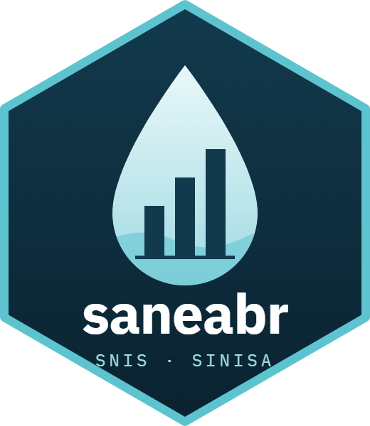

# saneabr: dados do SNIS e do SINISA em R e Python 

<table>
<tr>
<th><i>R</i></th>
<th><i>Python</i></th>
<th><i>Repositório</i></th>
</tr>
<tr>
<td>

[](https://CRAN.R-project.org/package=saneabr)<br>
[](https://CRAN.R-project.org/package=saneabr)<br>
[](https://CRAN.R-project.org/package=saneabr)<br>
[](https://lifecycle.r-lib.org/articles/stages.html#experimental)<br>
[](https://github.com/theoadepaula/saneabr/actions/workflows/check.yml)

</td>
<td>

[](https://pypi.org/project/saneabr/)<br>
[](https://pepy.tech/project/saneabr)<br>
[](https://pepy.tech/project/saneabr)<br>
[](https://lifecycle.r-lib.org/articles/stages.html#experimental)<br>
[](https://github.com/theoadepaula/saneabr/actions/workflows/check.yml)

</td>
<td>

[](https://github.com/theoadepaula/saneabr/stargazers)<br><br>
[](https://www.repostatus.org/#wip)

</td>
</tr>
</table>

O **saneabr** baixa e lê os dados municipais do **SNIS** (Sistema Nacional de
Informações sobre Saneamento) e do seu sucessor, o **SINISA** (Sistema Nacional
de Informações em Saneamento Básico), publicados pelo Ministério das Cidades.
Ele existe **em R e em Python**, com as mesmas funções e o mesmo resultado nas
duas linguagens.

Em três linhas, você sai de dezenas de planilhas espalhadas por anos e formatos
para uma tabela arrumada, com um município por linha:

```r
library(saneabr)
rs <- ler("snis", "rs", 2022)   # resíduos sólidos, 2022: 5.060 municípios
```

## Status: em validação pela comunidade, ainda não no CRAN/PyPI

O saneabr está na **v0.1, experimental**, e ainda **não foi publicado no CRAN
nem no PyPI**: instale pelo GitHub ([veja abaixo](#instalação)). Ele lê o
módulo de **resíduos sólidos** (SNIS 2014–2022 e SINISA 2023–2024); os demais
módulos e anos já estão no catálogo e podem ser baixados.

Antes de publicar, o pacote passa por uma **validação aberta**: a tabela que
liga os códigos de resíduos sólidos do SNIS aos do SINISA foi montada a partir
dos glossários oficiais e testada nos dados, mas precisa do olho de quem
trabalha com o tema. **Você pode ajudar sem programar**:
[veja como](#ajude-a-validar).

## Sumário

- [Status: em validação pela comunidade](#status-em-validação-pela-comunidade-ainda-não-no-cranpypi)
- [Por que este pacote existe](#por-que-este-pacote-existe)
- [O que são o SNIS e o SINISA](#o-que-são-o-snis-e-o-sinisa)
- [Instalação](#instalação)
- [Primeiros passos](#primeiros-passos)
- [Funções](#funções)
- [O que já dá para ler](#o-que-já-dá-para-ler)
- [Cuidados ao comparar SNIS e SINISA](#cuidados-ao-comparar-snis-e-sinisa)
- [Ajude a validar](#ajude-a-validar)
- [Como funciona por dentro](#como-funciona-por-dentro)
- [Licença e dados](#licença-e-dados)
- [Como citar](#como-citar)
- [Contribuir](#contribuir)
- [Pacotes relacionados](#pacotes-relacionados)

## Por que este pacote existe

Os dados do SNIS e do SINISA são públicos, mas trabalhar com eles dá trabalho:

- **Não há API.** Os dados saem em planilhas (xls, xlsx), dentro de arquivos zip
  ou rar, uma página por ano no site do Ministério.
- **O formato muda com o tempo.** Só no módulo de resíduos sólidos há quatro
  layouts diferentes entre 2002 e 2024, com o cabeçalho começando entre a 8ª e
  a 14ª linha, códigos em caixa mista e nome e UF juntos na mesma célula
  ("Abel Figueiredo/PA").
- **Os códigos mudaram em 2023.** Na passagem do SNIS para o SINISA, nenhum
  código de variável se manteve: `CO119` virou outra coisa, `IN015` virou
  `IRS0001`. O código de município também passou de 6 para 7 dígitos.
- **Os arquivos são republicados sem aviso** (`_atualizado_29112024`,
  `_Retificado`), e o que você baixou ontem pode não ser o que está lá hoje.

O saneabr resolve isso uma vez, de forma aberta e testada, para que cada
pesquisador, jornalista ou gestor não precise resolver de novo.

## O que são o SNIS e o SINISA

O **SNIS** reuniu, de 1995 a 2022, as informações declaradas pelos municípios e
prestadores sobre os serviços de saneamento. Em 2023 ele foi substituído pelo
**SINISA**, que mudou o questionário, os conceitos e os códigos.

Os dois se organizam em **módulos**, que o pacote identifica por uma sigla:

| Sigla | Módulo | SNIS | SINISA |
|---|---|---|---|
| `"rs"` | Resíduos sólidos (coleta, destinação, limpeza urbana) | 2002–2022 | 2023–2024 |
| `"ae"` | Água e esgoto | 1995–2022 | 2023–2024 |
| `"ap"` | Águas pluviais (drenagem) | 2015, 2017–2022 | 2023–2024 |
| `"gm"` | Gestão municipal (planos, políticas, consórcios) | — | 2023–2024 |

Cada ano tem várias **tabelas** (informações municipais, indicadores, unidades
de processamento, veículos…). Cada coluna de dado é identificada por um
**código**: no SNIS, códigos como `CO119` (quantidade de resíduos coletada) e
`IN015` (taxa de cobertura da coleta); no SINISA, códigos como `GTR1028` e
`IRS0001`. O dicionário, que o pacote também traz, diz o que cada código
significa.

## Instalação

**R** (versão de desenvolvimento, enquanto não está no CRAN):

```r
# install.packages("remotes")
remotes::install_github("theoadepaula/saneabr", subdir = "r")

# para ler os arquivos .rar do SINISA 2023, instale também:
install.packages("archive")
```

**Python** (versão de desenvolvimento, enquanto não está no PyPI):

```sh
pip install "git+https://github.com/theoadepaula/saneabr#subdirectory=python"

# com suporte aos arquivos .rar do SINISA 2023:
pip install "saneabr[rar] @ git+https://github.com/theoadepaula/saneabr#subdirectory=python"
```

Os dois pacotes moram em subpastas do mesmo repositório (`r/` e `python/`), por
isso o `subdir` e o `#subdirectory`.

No Linux, ler arquivos rar exige o `bsdtar` (`sudo apt install libarchive-tools`)
ou o `unrar`. No Windows e no macOS, nada a fazer.

## Primeiros passos

O caminho típico tem cinco passos. Os exemplos vêm em R e em Python; o
resultado é o mesmo.

### 1. Ver o que existe: `catalogo()`

O catálogo lista todos os arquivos conhecidos, com o endereço oficial, o
tamanho e a impressão digital (SHA-256) de cada um.

```r
catalogo(sistema = "snis", modulo = "rs")
```

```python
import saneabr
saneabr.catalogo(sistema="snis", modulo="rs")
```

### 2. Ver as tabelas de um ano: `tabelas()`

```r
tabelas("snis", "rs", 2022)
#> # A tibble: 7 × 3
#>   tabela                  descricao                                          padrao
#> 1 informacoes             Informacoes municipais (uma linha por municipio)   TRUE
#> 2 indicadores             Indicadores municipais (uma linha por municipio)   FALSE
#> 3 politicas_planos        Politicas, planos e consorcios (2016 em diante)    FALSE
#> 4 unidades_cadastro       Cadastro nacional de unidades de processamento     FALSE
#> ...
```

A tabela marcada como `padrao` é a que `ler()` devolve quando você não escolhe
nenhuma.

### 3. Ler os dados: `ler()`

`ler()` baixa o arquivo (só na primeira vez; depois usa o cache), acha a
planilha e o cabeçalho certos e devolve uma tabela arrumada.

```r
rs22 <- ler("snis", "rs", 2022)
dim(rs22)
#> [1] 5060  219

rs22[rs22$municipio == "Brasília", c("id_municipio", "municipio", "uf", "CO119")]
#>   id_municipio municipio uf     CO119
#> 1 5300108      Brasília  DF    723936
```

```python
rs22 = saneabr.ler("snis", "rs", 2022)
ind24 = saneabr.ler("sinisa", "rs", 2024, tabela="indicadores")
```

O que `ler()` faz por você:

- `id_municipio` sempre com **7 dígitos** (o código do IBGE), o mesmo do
  [geobr](https://github.com/ipea/geobr) e do
  [censobr](https://github.com/ipea/censobr), pronto para juntar com mapas e
  com o Censo;
- códigos de variável em maiúsculas e sem os enfeites do formulário
  (`Co119` → `CO119`, `GTR1030*` → `GTR1030`);
- nome do município e UF em colunas separadas;
- números como números.

### 4. Entender os códigos: `dicionario()`

```r
d <- dicionario("snis", "rs")
d[d$codigo == "CO119", c("codigo", "nome", "unidade")]
#>   codigo nome                                                        unidade
#> 1 CO119  QUANTIDADE TOTAL DE RDO E RPU COLETADA POR TODOS OS AGENTES Tonelada/ano
```

Cada linha do dicionário traz a definição, a unidade, a fórmula (nos
indicadores), os anos em que o código aparece e **o documento e a página** do
glossário oficial de onde o texto foi transcrito.

### 5. Ligar o SNIS ao SINISA: `correspondencia()`

Para montar uma série que atravessa 2022 → 2023, é preciso saber qual código do
SINISA corresponde a qual do SNIS, e se o conceito é o mesmo.

```r
correspondencia("rs")
```

```python
saneabr.correspondencia("rs")
```

Cada par vem com o **tipo de relação** (`igual`, `mudou_definicao`,
`mudou_unidade`, `desmembrado`, `agregado`) e a **evidência**: o documento e a
página que sustentam o par. Por padrão, só entram pares com evidência
documental; os sugeridos apenas por semelhança de nome ficam atrás de
`candidatas = TRUE`.

> ⚠️ Antes de emendar uma série, leia a [seção de cuidados](#cuidados-ao-comparar-snis-e-sinisa).
> "Mesmo nome" não quer dizer "mesmo conceito".

## Funções

| Função | O que faz |
|---|---|
| `catalogo(sistema, modulo, ano, tipo)` | lista os arquivos publicados, com URL, tamanho e SHA-256 |
| `baixar(sistema, modulo, ano, tipo = "dados", forcar = FALSE)` | baixa para o cache, confere o SHA-256 e avisa se a fonte republicou o arquivo |
| `tabelas(sistema, modulo, ano)` | mostra as tabelas que `ler()` sabe ler naquele ano |
| `ler(sistema, modulo, ano, tabela, arquivo)` | devolve a tabela arrumada; `arquivo` aceita um arquivo já baixado |
| `dicionario(sistema, modulo)` | dicionário de códigos extraído dos glossários oficiais |
| `correspondencia(modulo, candidatas = FALSE)` | pares de códigos SNIS ↔ SINISA, com tipo de relação e evidência |
| `mudancas(modulo)` | códigos renomeados, fórmulas e unidades alteradas *dentro* do SNIS |
| `dir_cache()` | onde ficam os arquivos baixados (mude com a variável `SANEABR_CACHE`) |
| `fonte_disponivel()` | diz se o gov.br está respondendo; nunca gera erro |

Sem internet, ou com o gov.br fora do ar, `baixar()` e `ler()` não quebram o
script: avisam (mensagem no R, `FonteIndisponivelAviso` no Python) e devolvem
`NULL` / `None`.

## O que já dá para ler

| | Resíduos sólidos | Água e esgoto | Águas pluviais | Gestão municipal |
|---|---|---|---|---|
| **SNIS 2014–2022** | ✅ `ler()` | ⬇️ `baixar()` | ⬇️ `baixar()` | — |
| **SNIS anos anteriores** | ⬇️ `baixar()` | ⬇️ `baixar()` | ⬇️ `baixar()` | — |
| **SINISA 2023–2024** | ✅ `ler()` | ⬇️ `baixar()` | ⬇️ `baixar()` | ⬇️ `baixar()` |

✅ lê e arruma · ⬇️ baixa e confere; a leitura chega nas próximas versões.

## Cuidados ao comparar SNIS e SINISA

O SINISA não é o SNIS com outro nome. Quatro mudanças afetam diretamente quem
monta séries históricas de resíduos sólidos (detalhes, documentos e páginas em
[`spec/NOTAS-MUDANCAS.md`](spec/NOTAS-MUDANCAS.md)):

1. **A massa coletada mudou de conceito.** O `CO119` do SNIS soma resíduos
   domiciliares e públicos coletados pelos agentes; o `GTR1028` do SINISA soma
   as massas declaradas por rota e inclui coleta seletiva, podas e entulho de
   pequenos geradores. Os números ficam parecidos, mas não são a mesma medida.
2. **O total nacional mudou de método.** O SNIS extrapolava uma amostra de
   municípios; o SINISA multiplica o per capita pela população total. Parte do
   salto entre 2022 e 2023 é método, não geração de lixo.
3. **A amostra mudou de natureza.** No SNIS, a resposta era voluntária e o
   conjunto de municípios mudava a cada ano. O SINISA publica os 5.570
   municípios, com valor vazio para quem não respondeu.
4. **Os indicadores per capita mudaram de denominador**, de população atendida
   para população total. O par mais limpo entre os dois sistemas é a taxa de
   cobertura da coleta (`IN015` → `IRS0001`).

### Quem já tratou da transição (e o que ainda falta)

A correspondência do saneabr parte do que já foi publicado. Até onde a busca
alcançou (novembro de 2026), **não existe uma tabela pública que ligue os
códigos de resíduos sólidos do SNIS aos do SINISA**. O que existe, e merece o
crédito:

- **Ministério das Cidades**: os glossários do SINISA trazem uma coluna
  "similar no SNIS" e, em parte dos campos, uma "Referência" ao código antigo.
  É a fonte primária de quase todos os pares documentados do pacote, e também
  onde a validação achou erros (por exemplo, `IN018`, que é produtividade, ligado
  a `IFR0002`, que é empregados por mil habitantes).
- **Agência Nacional de Águas e Saneamento Básico (ANA)**: a
  [Análise de Impacto Regulatório da Norma de Referência de indicadores de
  resíduos sólidos urbanos](https://participacao-social.ana.gov.br/api/files/2025_08_29_RAIR_Indicadores_RSU_LU_v12-1756906338835.pdf)
  (29/08/2025, p. 19) trata `IN031` e `IRS3010` (recuperação de recicláveis)
  como uma série contínua. O par entrou na validação, com a ressalva de que o
  `IRS3010` inclui orgânicos e o `IN031` não.
- **Instituto Trata Brasil e GO Associados**: o
  [Estudo sobre as alterações metodológicas do SINISA em relação ao SNIS](https://tratabrasil.org.br/wp-content/uploads/2025/07/Versao-Final-do-Estudo-da-GO-Associados-Trata-Brasil-SNIS-SINISA_Rio-corrigido-3.pdf)
  (15/07/2025) lista os indicadores de **água e esgoto** que se mantiveram e os
  que mudaram, e monta uma série consolidada SNIS+SINISA. Não cobre resíduos
  sólidos, mas será a referência quando o pacote ler o módulo `"ae"`.
- **Projeto Acertar (Ministério das Cidades e ABAR)**: o
  [Ofício nº 130/2025](https://www.gov.br/cidades/pt-br/acesso-a-informacao/acoes-e-programas/saneamento/sinisa/projeto-acertar/SEI_MIDR5858479Ofcio.pdf)
  menciona uma "Planilha Acertar – Transição SNIS_SINISA" (SEI nº 5901479),
  acordada com as agências reguladoras para a auditoria de água e esgoto. Ela
  não está publicada.
- **Instituto Água e Saneamento**: registra, nas suas
  [fontes e notas técnicas](https://www.aguaesaneamento.org.br/municipios-e-saneamento/fontes-notas-tecnicas),
  que o SINISA "ainda não foi compatibilizado com a série histórica".

Se você conhece outro trabalho, abra uma issue: ele entra aqui com o devido
crédito.

## Ajude a validar

> **É o principal pedido de ajuda do projeto, e não exige programar.** Basta
> uma conta gratuita no GitHub e conhecer os campos do SNIS ou do SINISA.

A tabela de correspondência de resíduos sólidos está **em validação**. Cada um
dos 147 pares documentados (mais 10 pares novos) foi lido nos glossários e,
quando possível, testado nos dados: para os municípios que responderam aos dois
sistemas, compara-se o valor do SNIS 2022 com o do SINISA 2023. O resultado
está em [`validacao/LISTA-RS.md`](validacao/LISTA-RS.md), com o veredito, a
razão observada e a página de cada glossário.

Quem trabalha com resíduos sólidos (em prefeitura, prestador, agência
reguladora, consultoria ou pesquisa) pode ajudar muito:

1. abra a [lista](validacao/LISTA-RS.md) e procure os códigos que você conhece
   (ela começa pelos pares mais usados: massa coletada, cobertura, per capita,
   custos, receitas, coleta seletiva, destinação, limpeza urbana e
   trabalhadores);
2. se discordar de um veredito, ou souber de um par que falta, preencha o
   formulário [**Validação de par ou de dicionário**](https://github.com/theoadepaula/saneabr/issues/new?template=validacao.yml):
   ano, código, fonte, o que está errado e a evidência (documento e página, um
   link, ou a sua experiência de preencher o formulário);
3. se concordar, diga isso na [issue de validação do
   tema](https://github.com/theoadepaula/saneabr/issues?q=is%3Aissue+label%3Avalida%C3%A7%C3%A3o):
   uma confirmação de quem preenche o formulário também conta;
4. cada decisão entra no pacote com a data, o responsável e a evidência, e quem
   ajudou é creditado.

O mesmo formulário serve para erros nos **dicionários** (nome, definição,
unidade, fórmula ou página de um código). O passo a passo completo está no
[guia de contribuição](CONTRIBUTING.md#1-ajudar-a-validar-sem-programar).

Água e esgoto e águas pluviais vêm depois, pelo mesmo caminho.

## Como funciona por dentro

Todo o conhecimento sobre as fontes (onde estão os arquivos, como achar o
cabeçalho em cada formato, como normalizar códigos, o que cada código
significa) fica numa **especificação neutra**, em arquivos CSV e JSON na pasta
[`spec/`](spec/). Os pacotes R e Python só interpretam essa especificação.

```
              spec/  (catálogo, regras de leitura, dicionários, correspondência)
             ┌──────────────────────┴──────────────────────┐
         pacote R                                     biblioteca Python
             └──────────────── mesmo resultado ────────────┘
```

Isso traz duas garantias:

- **Um conserto vale para as duas linguagens.** Quando o Ministério republica
  um arquivo ou muda um layout, a correção é feita uma vez, na spec.
- **R e Python são conferidos um contra o outro.** Um teste de paridade lê
  todos os anos cobertos nas duas linguagens e exige linhas, colunas, tipos e
  valores idênticos (91 de 91 tabelas na v0.1).

## Licença e dados

- **Código e especificação:** licença [MIT](LICENSE).
- **Dados:** são do Ministério das Cidades e **não vêm dentro do pacote**: cada
  usuário baixa da fonte oficial, e o pacote confere que o arquivo é o
  esperado. Os dados de saneamento são abertos, de livre utilização com
  crédito à fonte (Decreto 8.777/2016; Lei 14.129/2021). A análise completa
  está em [`LICENCA-DADOS.md`](LICENCA-DADOS.md).
- **Dicionários:** os textos de nome, definição e unidade são transcritos sem
  alteração dos glossários oficiais, com documento e página citados em cada
  linha.

Ao publicar um resultado, cite a fonte dos dados (Ministério das Cidades,
SNIS/SINISA) e, se o pacote ajudou, cite o saneabr.

## Como citar

> de Paula, T. (2026). *saneabr: acesso aos dados do SNIS e do SINISA em R e
> Python*. Versão 0.1.0. https://github.com/theoadepaula/saneabr

```bibtex
@software{saneabr,
  author  = {de Paula, Théo},
  title   = {saneabr: acesso aos dados do SNIS e do SINISA em R e Python},
  year    = {2026},
  version = {0.1.0},
  url     = {https://github.com/theoadepaula/saneabr}
}
```

## Contribuir

Toda ajuda é bem-vinda, e a mais urgente não exige código:
[validar a correspondência](#ajude-a-validar).

- **Validação de par ou de dicionário, bug ou pedido de recurso**: abra uma
  [issue](https://github.com/theoadepaula/saneabr/issues/new/choose) pelo
  formulário de cada caso.
- **Dúvidas de uso**: nas
  [Discussions](https://github.com/theoadepaula/saneabr/discussions).
- **Código ou especificação**: o [guia de contribuição](CONTRIBUTING.md) explica
  como rodar os pacotes, os testes e por que toda mudança vale para R e Python
  juntos. Issues marcadas com
  [`good first issue`](https://github.com/theoadepaula/saneabr/labels/good%20first%20issue)
  são um bom começo.

Quem participa segue o [código de conduta](CODE_OF_CONDUCT.md).

## Pacotes relacionados

O saneabr segue o espírito dos pacotes de dados brasileiros reunidos no
[brverse](https://github.com/ipea/brverse), do Ipea, e foi pensado para
conversar com eles pelo código de município:

- [geobr](https://github.com/ipea/geobr): malhas territoriais oficiais (mapas);
- [censobr](https://github.com/ipea/censobr): dados do Censo Demográfico;
- [basedosdados](https://basedosdados.org/): tem o SNIS de água e esgoto em
  BigQuery.

---

Desenvolvido por [Théo de Paula](https://theoalbuquerque.com.br). Os dados são
do Ministério das Cidades (Secretaria Nacional de Saneamento Ambiental).
