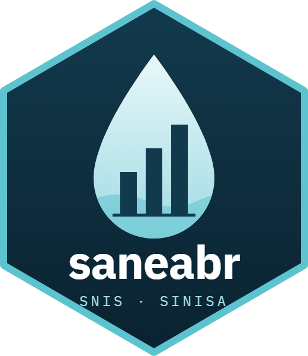

# saneabr (Python) 

Acesso aos dados do **SNIS** (Sistema Nacional de Informações sobre Saneamento)
e do **SINISA** (Sistema Nacional de Informações em Saneamento Básico), do
Ministério das Cidades. Baixa os arquivos da fonte oficial, confere o SHA-256 e
devolve DataFrames arrumados: códigos de variável normalizados (`CO119`,
`GTR1028`) e município com 7 dígitos (`id_municipio`).

As regras de leitura vêm de uma especificação compartilhada com o pacote R
[`saneabr`](https://github.com/theoadepaula/saneabr): as duas linguagens dão o
mesmo resultado.

```
pip install saneabr          # rar (SINISA 2023): pip install "saneabr[rar]"
```

```python
import saneabr

saneabr.catalogo(sistema="sinisa", modulo="rs")   # arquivos conhecidos
saneabr.tabelas("snis", "rs", 2022)                # o que ler() sabe ler
rs22 = saneabr.ler("snis", "rs", 2022)             # informações municipais
ind24 = saneabr.ler("sinisa", "rs", 2024, tabela="indicadores")
saneabr.dicionario("sinisa", "rs")
saneabr.correspondencia("rs")                      # pares SNIS-SINISA com evidência
```

**Cobertura da v0.1:** leitura do módulo de resíduos sólidos (RS), SNIS
2014–2022 e SINISA 2023–2024. Os demais módulos e anos estão no catálogo e podem
ser baixados com `baixar()`.

**Cache:** `platformdirs.user_cache_dir("saneabr")`, ou a variável de ambiente
`SANEABR_CACHE`.

**Sem internet**, ou com o gov.br fora do ar, `baixar()` e `ler()` não levantam
exceção: emitem `saneabr.FonteIndisponivelAviso` e devolvem `None`.
`saneabr.fonte_disponivel()` diz antes se a fonte está respondendo.

**Antes de empilhar SNIS e SINISA**, leia a ajuda de `correspondencia()` e as
[notas de mudanças](https://github.com/theoadepaula/saneabr/blob/master/spec/NOTAS-MUDANCAS.md): os códigos e
conceitos mudaram (por exemplo, CO119 não é GTR1028).

Mais:
[documentação completa e exemplos](https://github.com/theoadepaula/saneabr#readme) ·
[como as planilhas são lidas](https://github.com/theoadepaula/saneabr/blob/master/spec/README.md) ·
[licença dos dados](https://github.com/theoadepaula/saneabr/blob/master/LICENCA-DADOS.md) ·
[mudanças por versão](https://github.com/theoadepaula/saneabr/blob/master/python/CHANGELOG.md) ·
[problemas e sugestões](https://github.com/theoadepaula/saneabr/issues)

Dados: Brasil, Ministério das Cidades, SNIS e SINISA. Livre utilização com
citação da fonte. Código: MIT.
